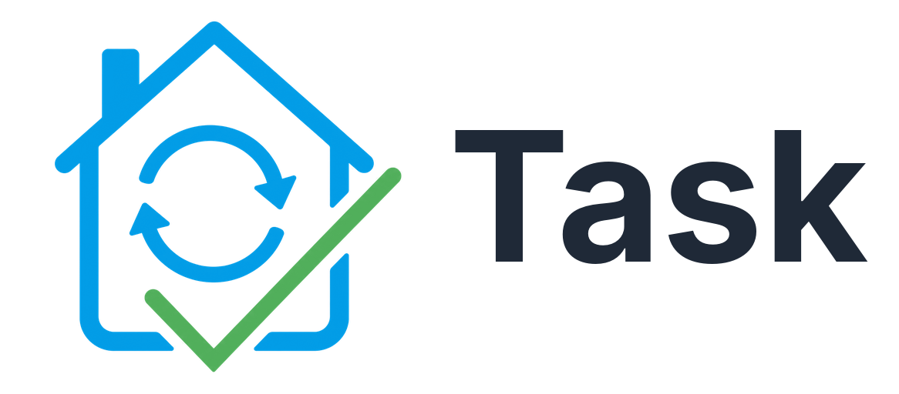
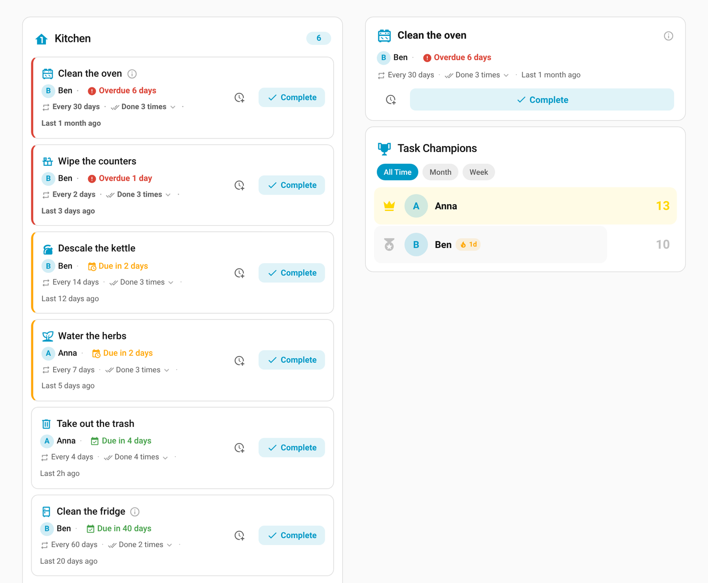
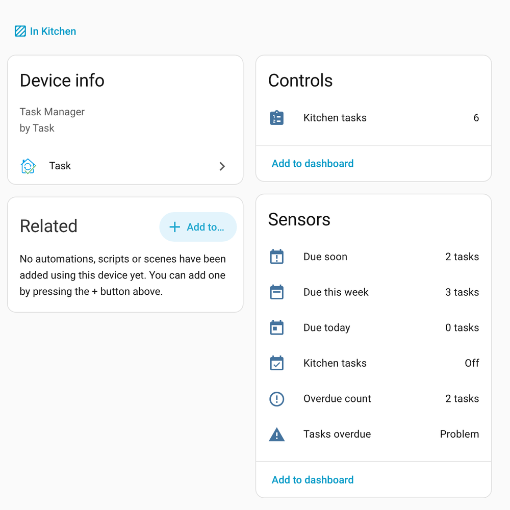
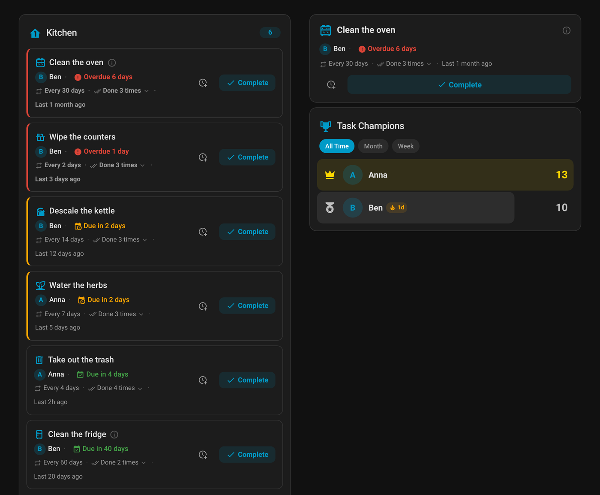
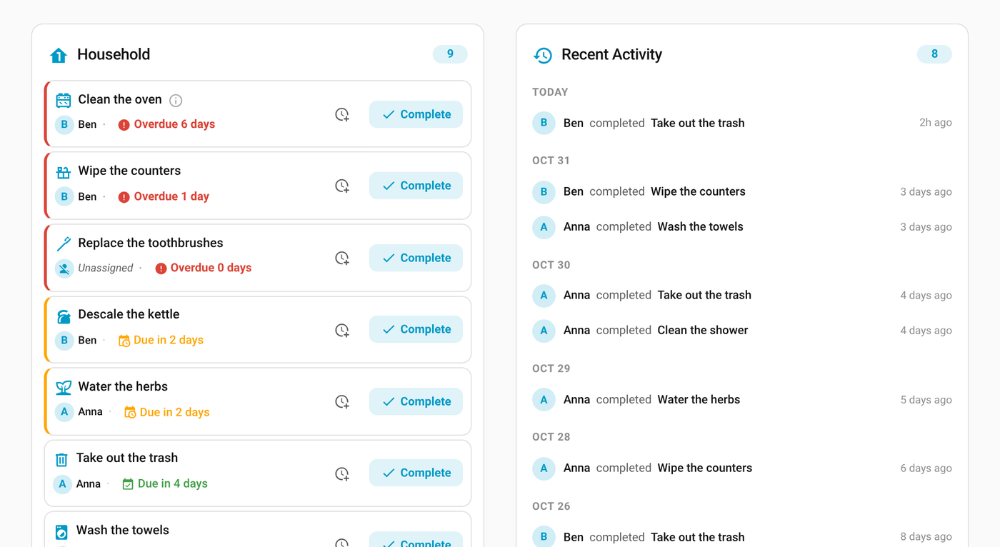
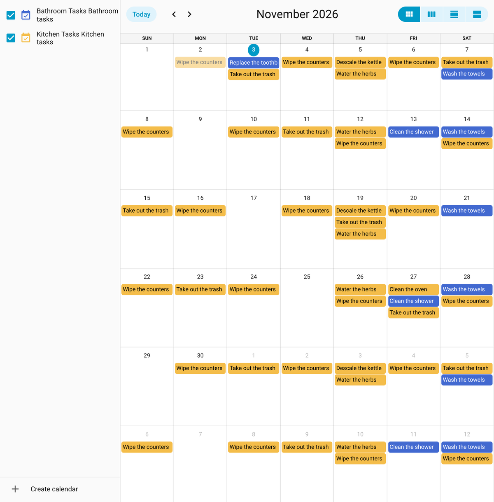

<p align="center">
  
</p>

# Task — Haushaltsaufgaben für Home Assistant

[![HACS][hacs-badge]][hacs-url]
[![Release][release-badge]][release-url]
[![Validate][validate-badge]][validate-url]
[![License][license-badge]][license-url]

🇬🇧 [English version](README.md)

Eine Home-Assistant-Integration für wiederkehrende Haushaltsaufgaben und die Wartung von Geräten. Aufgaben werden nach Bereichen geordnet, reihum an Haushaltsmitglieder verteilt, mit Verlauf festgehalten, und du wirst rechtzeitig vor der Fälligkeit und bei Überfälligkeit benachrichtigt.

[![Dieses Repository im Home Assistant Community Store öffnen.][hacs-my-badge]][hacs-my-url]



## Funktionen

- **Wiederkehrende Aufgaben** — Intervalle von 1 bis 365 Tagen, die Fälligkeit wird automatisch berechnet.
- **Gerätewartung** — Wartungsaufgaben an ein Gerät binden (Filter wechseln, entkalken, reinigen), Intervalle bis 730 Tage.
- **Reihum-Zuweisung** — Mehrere Personen zuweisen, die Zuständigkeit wechselt reihum oder zufällig.
- **„Mir zuweisen“** — Jeder kann eine nicht zugewiesene Aufgabe direkt übernehmen.
- **Bald fällig und überfällig** — Jede Aufgabe hat einen Status (`ok`, `due_soon`, `overdue`). Die Warntage gelten pro Bereich und lassen sich pro Aufgabe überschreiben.
- **Summen-Sensoren** — Pro Bereich: Anzahl überfälliger, heute fälliger, diese Woche fälliger und bald fälliger Aufgaben.
- **Verschieben** — Eine Aufgabe nach hinten schieben, ohne sie als erledigt zu zählen, per Service oder in der Karte.
- **Rückdatierte Erledigung** — Festhalten, dass etwas gestern erledigt wurde. Die nächste Fälligkeit rechnet ab dann.
- **Kalender** — Alle Fälligkeiten erscheinen im Home-Assistant-Kalender.
- **Todo-Liste** — Aufgaben als native HA-Todo-Einträge, erledigen direkt in der Todo-Ansicht.
- **Verlauf** — Wer hat was wann erledigt, mit Statistik pro Person.
- **Ereignisse** — `task_completed`, `task_due_soon`, `task_overdue` und die `maintenance_*`-Gegenstücke für Automationen.
- **Katalog-Import** — Starte mit 80 fertigen Haushaltsaufgaben auf Deutsch oder Englisch.
- **Blueprints** — Benachrichtigungs-Blueprints werden automatisch installiert.
- **Lovelace-Karten** — Vier Karten mit visuellem Editor: `task-card`, `task-single-card`, `task-activity-card` und `task-ranking-card`.

## Installation

### HACS (empfohlen)

Task ist im Standard-Store von HACS verfügbar.

1. HACS in Home Assistant öffnen.
2. Nach **Task** suchen und öffnen.
3. **Herunterladen** wählen.
4. Home Assistant neu starten.

Alternativ über den Button oben direkt per [My Home Assistant](https://my.home-assistant.io/) öffnen.

Benötigt Home Assistant 2025.4 oder neuer.

### Manuell

1. Das neueste Release von der Seite [Releases](https://github.com/Kogoro/ha-task/releases) herunterladen.
2. Den Ordner `custom_components/task/` nach `config/custom_components/` kopieren.
3. Home Assistant neu starten.

## Schnellstart

1. Task über HACS installieren und Home Assistant neu starten.
2. **Einstellungen** → **Geräte & Dienste** → **Integration hinzufügen**, nach **Task** suchen, **Bereich** wählen und den Bereich auswählen.
3. Beim neuen Eintrag **Aufgabe hinzufügen** wählen (Name und Intervall) — oder **Aufgaben aus dem Katalog importieren**.
4. Die Karte zum Dashboard hinzufügen: **Dashboard bearbeiten** → **Karte hinzufügen** → **Task**, oder in YAML:

   ```yaml
   type: custom:task-card
   area: kitchen
   ```

5. Auf **Complete** tippen, wenn eine Aufgabe erledigt ist. Die nächste Fälligkeit wird berechnet.

## Einrichtung

Alles läuft über die Oberfläche, YAML ist nicht nötig.

- **Bereich:** Jeder Bereich hat seinen eigenen Eintrag. Dort stellst du die **Warntage** ein (Standard 7). Aufgaben zählen so viele Tage vor der Fälligkeit als „bald fällig“.
- **Aufgabe:** Name, Intervall (1–365 Tage), Beschreibung, Symbol, optional **Warntage** (überschreibt den Wert des Bereichs, leer lassen für den Bereichswert) und Zuständige mit Rotation.
- **Wartung:** wie eine Aufgabe, zusätzlich mit Gerät und Intervall bis 730 Tage.

### Haushaltsübersicht (optional)

Über dasselbe Menü lässt sich die **Haushaltsübersicht** hinzufügen, ein Ort für das ganze Zuhause. Es kann nur eine geben.

- **Summen über alle Bereiche:** überfällig, heute fällig, diese Woche fällig und bald fällig. In den Attributen stehen die Aufgaben als „Bereich: Aufgabe“. Die Werte sind immer die Summe der Bereiche.
- **Ein Kalender mit den Aufgaben aller Bereiche** (standardmäßig „All Tasks“, umbenennbar über „Neu konfigurieren“). Er hängt nicht mehr an einem einzelnen Bereich und bleibt bestehen, wenn du einen Bereich entfernst oder neu lädst.

Sobald es eine Haushaltsübersicht gibt, bietet jeder Bereich **Eigenen Kalender dieses Bereichs ausblenden**: Die Aufgaben erscheinen dann nur im Haushaltskalender. Entfernst du die Haushaltsübersicht, bekommen diese Bereiche ihren eigenen Kalender zurück.

Beim Update von einer Version, in der ein Bereich den vereinheitlichten Kalender nutzte, wird die Haushaltsübersicht automatisch angelegt und übernimmt Name, Entity-ID und Verlauf des Kalenders.

### Entities

Pro Aufgabe oder Wartung:

| Entity | Beschreibung |
|--------|--------------|
| `sensor.<name>` | Tage bis zur Fälligkeit (negativ, wenn überfällig) |
| `sensor.<name>_status` | `ok`, `due_soon` (innerhalb der Warntage) oder `overdue` |
| `binary_sensor.<name>_overdue` | `on`, wenn die Aufgabe überfällig ist |
| `button.<name>_complete` | Erledigung festhalten |
| `button.<name>_assign_to_me` | Aufgabe übernehmen |

Pro Bereich (am Gerät „<Bereich> Tasks“; die Entity-IDs entstehen aus Bereichs- und Gerätenamen):

| Entity | Beschreibung |
|--------|--------------|
| Tasks overdue (Binärsensor) | `on`, wenn im Bereich etwas überfällig ist |
| Anzahl überfällig | Anzahl überfälliger Aufgaben; Attribute `tasks` (Namen) und `assignees` |
| Heute fällig | Anzahl der heute fälligen Aufgaben |
| Diese Woche fällig | Anzahl der in den nächsten 7 Tagen fälligen Aufgaben |
| Bald fällig | Anzahl der Aufgaben innerhalb ihrer Warntage |
| Kalender, Todo-Liste | Alle Fälligkeiten und Aufgaben des Bereichs |



### Services

| Service | Beschreibung |
|---------|--------------|
| `task.complete_task` | Aufgabe als erledigt festhalten und die Zuständigkeit weiterschalten. Mit `completed_at` lässt sich eine frühere Erledigung nachtragen. |
| `task.postpone_task` | Fälligkeit um `days` Tage (Standard 1) nach hinten schieben, ohne eine Erledigung zu zählen. Gerechnet ab der aktuellen Fälligkeit, bei überfälligen Aufgaben ab heute. |
| `task.reset_task` | Verlauf und Rotation einer Aufgabe zurücksetzen |

### Ereignisse

| Ereignis | Wird ausgelöst, wenn |
|----------|----------------------|
| `task_completed` / `maintenance_completed` | eine Aufgabe erledigt wird |
| `task_due_soon` / `maintenance_due_soon` | eine Aufgabe ihre Warntage erreicht (einmal pro Fälligkeit) |
| `task_overdue` / `maintenance_overdue` | eine Aufgabe überfällig wird |

## Lovelace-Karten

Die vier Karten werden automatisch registriert und haben einen visuellen Editor. Alle Optionen stehen in der [englischen README](README.md#lovelace-cards).

| Karte | Zweck |
|-------|-------|
| `task-card` | Aufgaben eines oder mehrerer Bereiche mit Filter, Sortierung und Verlauf |
| `task-single-card` | Eine einzelne Aufgabe, z. B. für Gerätedashboards |
| `task-activity-card` | Wer hat zuletzt was erledigt |
| `task-ranking-card` | Rangliste der Haushaltsmitglieder |

```yaml
type: custom:task-card
areas:
  - kitchen
  - bathroom
title: Haushalt
sort_by: due_date
```

## Screenshots

Die Karten auch im Dunkelmodus:



Kompakte Liste über mehrere Bereiche neben dem Aktivitäts-Feed:



Alle Fälligkeiten im Kalender:



## Automation

Benachrichtigung, wenn eine Aufgabe bald fällig ist:

```yaml
automation:
  - alias: "Aufgabe bald fällig"
    triggers:
      - trigger: event
        event_type: task_due_soon
    actions:
      - action: notify.mobile_app
        data:
          title: "Bald fällig"
          message: >
            {{ trigger.event.data.task_name }} ({{ trigger.event.data.area_name }})
            ist in {{ trigger.event.data.days_until_due }} Tagen fällig.
```

## FAQ und Fehlersuche

**HACS zeigt nicht die neueste Version.** In HACS Task öffnen, **⋮** → **Informationen aktualisieren**. Wird weiter eine alte Version angezeigt, **Erneut herunterladen** wählen und das neueste Release auswählen. Danach Home Assistant neu starten.

**Die Karte sieht nach einem Update alt aus.** Das Karten-Skript liegt im Browser-Cache. Die Seite hart neu laden (Strg+Shift+R) oder in der Companion App den Cache leeren.

**Eine neue Aufgabe ist sofort überfällig.** Eine Aufgabe ohne Erledigung gilt als sofort fällig. Einmal erledigen (oder mit `completed_at` angeben, wann sie zuletzt gemacht wurde), dann beginnt das Intervall.

**Was sind Warntage?** Eine Aufgabe zählt so viele Tage vor ihrer Fälligkeit als „bald fällig“. Der Standard gilt pro Bereich, eine Aufgabe kann ihn überschreiben. Bleibt das Feld bei der Aufgabe leer, gilt der Wert des Bereichs.

**Wartungs-Entities sind nach 0.3.1 an einem anderen Gerät.** Seit Home Assistant 2026.8 darf ein Gerät nur zu einer Integration gehören. Jede Wartung hat jetzt ein eigenes Gerät „Device Maintenance“, das mit dem Gerät verknüpft ist. Die Entity-IDs haben sich nicht geändert.

**Ich möchte ein Problem melden.** Bitte ein [Issue öffnen](https://github.com/Kogoro/ha-task/issues), mit den Versionen von Home Assistant und Task und den passenden Logzeilen.

## Lizenz

Dieses Projekt steht unter der Apache License 2.0, siehe [LICENSE](LICENSE).

[hacs-badge]: https://img.shields.io/badge/HACS-Default-41BDF5.svg
[hacs-url]: https://hacs.xyz
[release-badge]: https://img.shields.io/github/v/release/Kogoro/ha-task
[release-url]: https://github.com/Kogoro/ha-task/releases
[validate-badge]: https://img.shields.io/github/actions/workflow/status/Kogoro/ha-task/validate.yml?branch=main&label=validate
[validate-url]: https://github.com/Kogoro/ha-task/actions/workflows/validate.yml
[license-badge]: https://img.shields.io/github/license/Kogoro/ha-task
[license-url]: https://github.com/Kogoro/ha-task/blob/main/LICENSE
[hacs-my-badge]: https://my.home-assistant.io/badges/hacs_repository.svg
[hacs-my-url]: https://my.home-assistant.io/redirect/hacs_repository/?owner=Kogoro&repository=ha-task&category=integration
