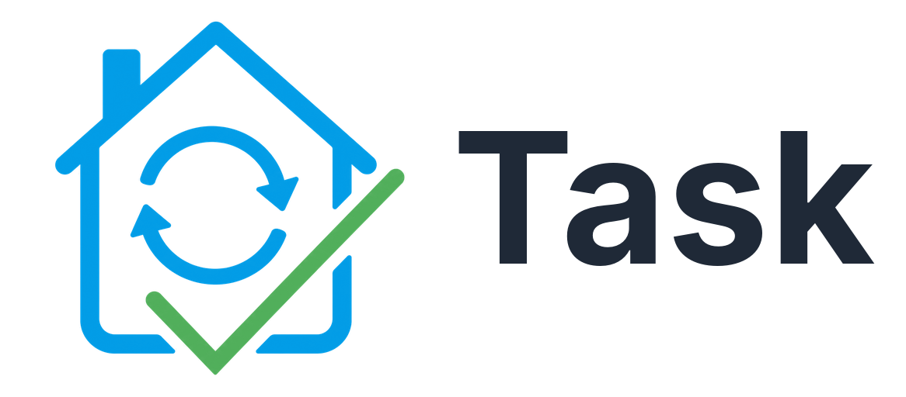
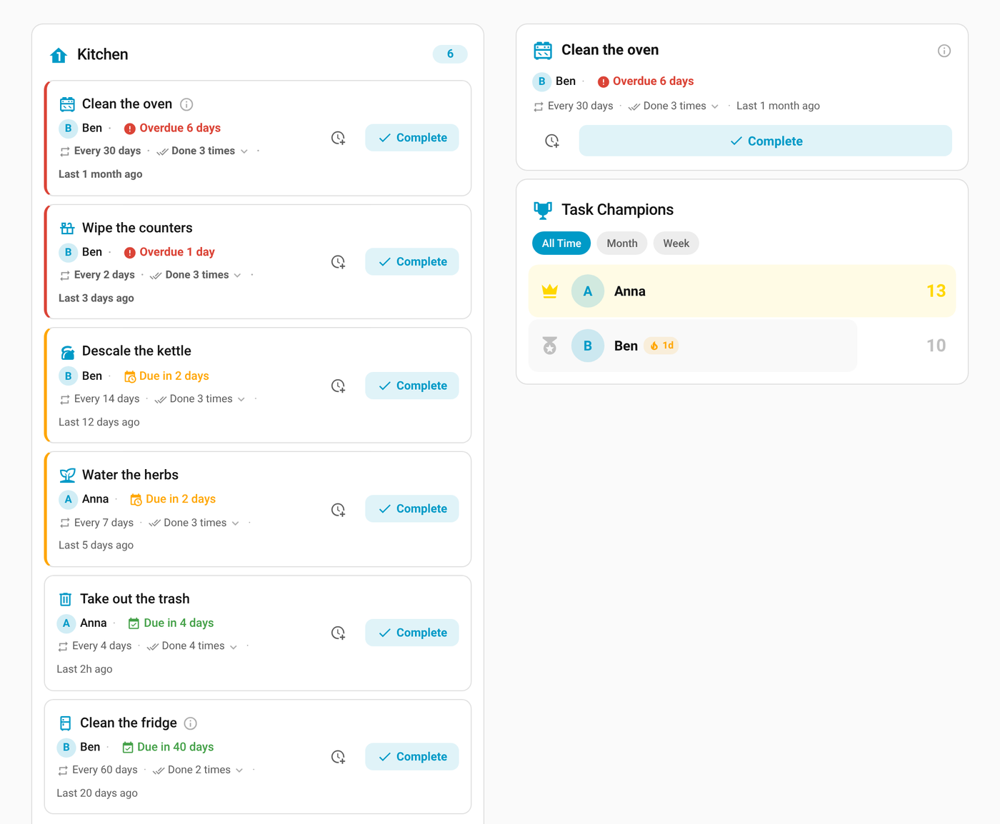
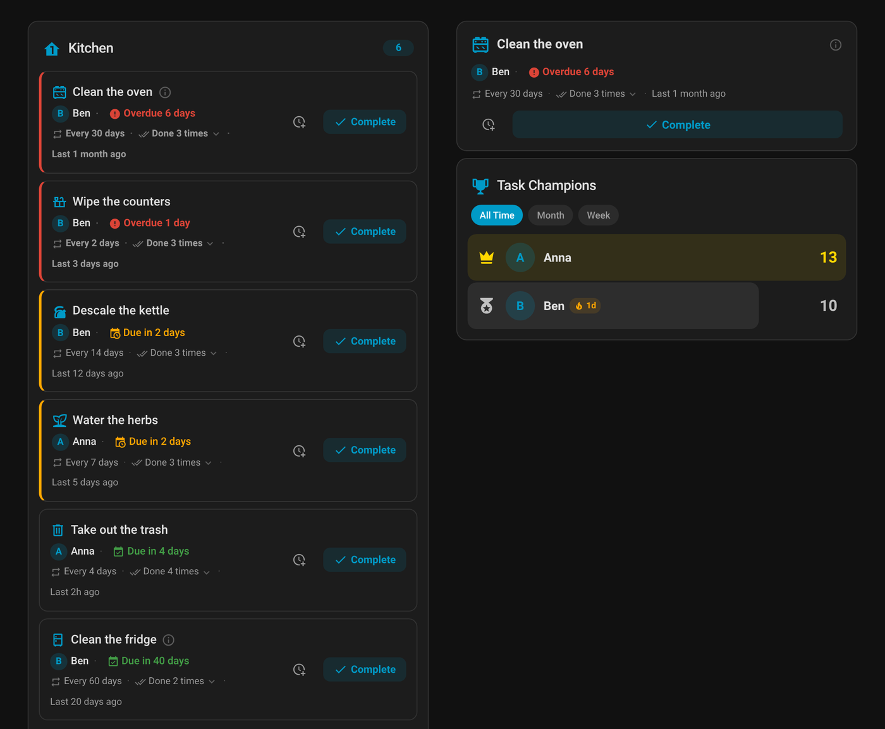
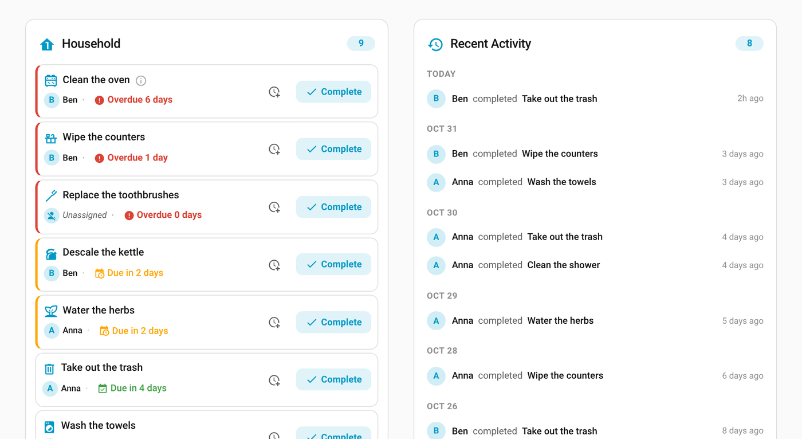
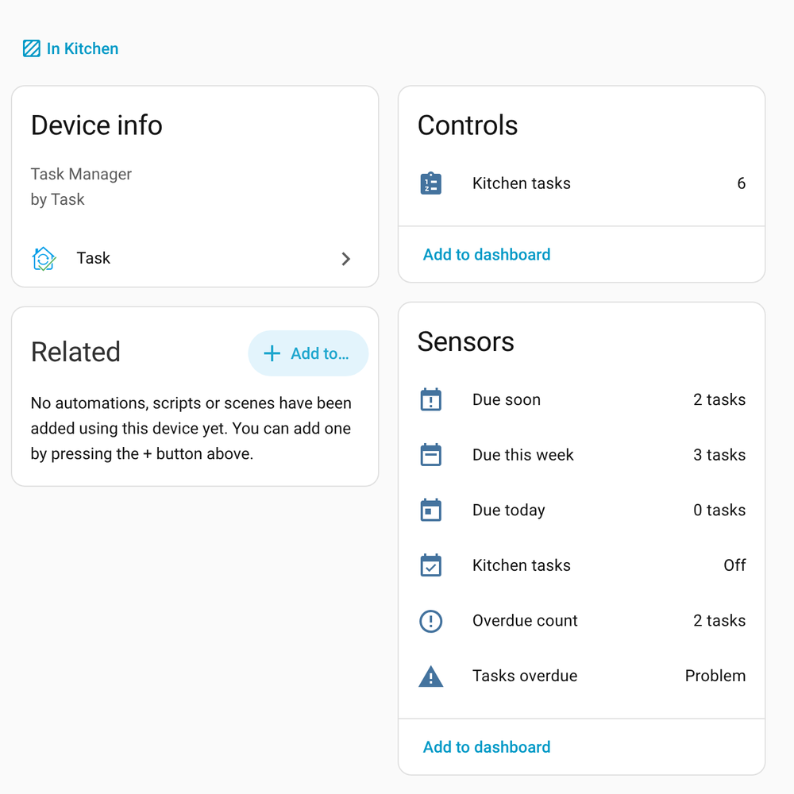
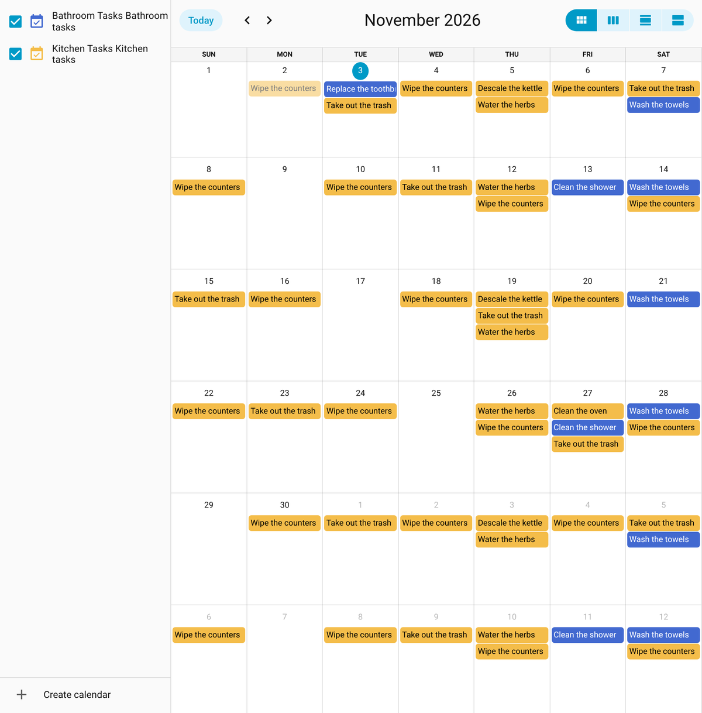

# Task — Household Task Management for Home Assistant

<p align="center">
  
</p>

[![HACS][hacs-badge]][hacs-url]
[![Release][release-badge]][release-url]
[![Validate][validate-badge]][validate-url]
[![License][license-badge]][license-url]

🇩🇪 [Deutsche Version](README.de.md)

A Home Assistant integration for managing recurring household tasks and device maintenance schedules. Organize tasks by area, assign them to household members with automatic rotation, track completion history, and get notified before tasks are due and when they are overdue.

[![Open your Home Assistant instance and show the Task repository inside the Home Assistant Community Store.][hacs-my-badge]][hacs-my-url]

## Features

- **Recurring tasks** — Define tasks with customizable intervals (1–365 days) and track due dates automatically.
- **Device maintenance** — Link maintenance tasks to specific devices (filter changes, cleaning, descaling) with intervals up to 730 days.
- **Assignee rotation** — Assign multiple household members and rotate responsibility using round-robin or random mode. People who are away (holiday, illness) are skipped, with an optional date range.
- **"Assign to me" button** — Any user can claim an unassigned task directly from the UI.
- **Due soon and overdue** — Every task has a status (`ok`, `due_soon`, `overdue`). Warn days are set per area and can be overridden per task. Binary sensors flag overdue tasks.
- **Summary sensors** — Per area: how many tasks are overdue, due today, due this week and due soon.
- **Postpone** — Push a task back without counting it as done, from a service or the card.
- **Backdated completion** — Record that something was done yesterday; the next due date counts from then.
- **Calendar integration** — View all task due dates on a Home Assistant calendar with recurring events.
- **Todo list** — Interact with tasks as native HA todo items; create tasks and mark them complete from the todo panel.
- **Completion history** — Persistent per-task history tracks who completed what and when, with per-person statistics, the actual cycle length compared with the plan, and an undo for the last completion (service and a button in the card's history).
- **Events** — Fires `task_completed`, `task_due_soon`, `task_overdue` and their `maintenance_*` counterparts for use in automations.
- **Catalog import** — Start with 80 ready-made household tasks in English or German.
- **Blueprints** — Notification blueprints are installed automatically.
- **Lovelace cards** — Four cards with a built-in visual editor: `task-card` (area view), `task-single-card` (single task), `task-activity-card` (recent completions) and `task-ranking-card` (household leaderboard).
- **Area-based organization** — Each config entry maps to a Home Assistant area; tasks and maintenance items are managed as config subentries.

## Installation

### HACS (Recommended)

Task is available in the default HACS store.

1. Open HACS in your Home Assistant instance.
2. Search for **Task** and open it.
3. Click **Download**.
4. Restart Home Assistant.

Or click the button above to open it directly via [My Home Assistant](https://my.home-assistant.io/).

Requires Home Assistant 2025.4 or newer.

### Manual Installation

1. Download the latest release from the [Releases](https://github.com/Kogoro/ha-task/releases) page.
2. Copy the `custom_components/task/` directory to your Home Assistant `config/custom_components/` directory.
3. Restart Home Assistant.

## Quick start

1. Install Task via HACS and restart Home Assistant.
2. Go to **Settings** → **Devices & Services** → **Add Integration**, search for **Task** and pick an area.
3. On the new entry, click **Add task** (name and interval) — or **Import from catalog** to start with ready-made tasks.
4. Add the card to a dashboard: **Edit dashboard** → **Add card** → **Task**, or in YAML:

   ```yaml
   type: custom:task-card
   area: kitchen
   ```

5. Press **Complete** when a task is done. The next due date is calculated for you.

## Configuration

Task is configured entirely through the Home Assistant UI — no YAML needed.

### Adding an Area

1. Go to **Settings** → **Devices & Services** → **Add Integration**.
2. Search for **Task** and select it.
3. Choose **Area**, then the area you want to manage tasks for. Each area gets its own config entry.
4. Optionally set **Warn days** (default 7): tasks count as "due soon" this many days before they are due.

### Household overview (optional)

Add **Household overview** from the same menu to get one place for the whole home. There can be only one.

- **Totals across all areas:** overdue, due today, due this week and due soon, with the tasks as "Area: task" in the attributes. They always add up the area values.
- **One calendar with the tasks of all areas** ("All Tasks" by default; you can rename it by reconfiguring the entry). It no longer depends on a single area, so it stays when you remove or reload any area.

Once a household overview exists, an area offers **Hide this area's separate calendar**: its tasks then appear only in the household calendar. If you remove the household overview, those areas get their own calendar back.

Upgrading from a version where an area used the unified calendar: the household overview is created automatically and takes over the calendar's name, entity ID and history.

### Adding Tasks

1. Navigate to the Task integration entry for an area.
2. Click **Add task** to create a recurring household task.
3. Provide:
   - **Task name** — e.g., "Vacuum living room" or "Water plants"
   - **Repeat every** — interval between occurrences (1–365) in **days, weeks or calendar months**. Months keep the day of the month (31 January + 1 month is 28 February)
   - **Active months** — optional; the task is only due in these months, e.g. March to May for window cleaning (see below)
   - **Description** — optional notes or instructions
   - **Icon** — optional MDI icon
   - **Warn days** — optional; overrides the area's warn days for this task (leave empty to use the area value)
   - **Effort (points)** — how much work the task is (default 1). The ranking card counts points instead of completions, and the workload rotation uses them
   - **Assignees** — optionally assign people with a rotation mode: round-robin, random, or **least workload**

#### Seasonal tasks (active months)

Pick the months a task applies to. Outside them the task is **neither due nor overdue**, does not count in the totals and has no calendar events; it comes back on the first day of the next active month.

- Done on 25 September with active months April–September and a weekly interval: the next due date is 1 April of the next year, not 2 October.
- A task that was never completed and is not in season is due when the season starts, not immediately.
- If the due date is missed and the season ends, the task simply waits for the next season instead of showing as overdue.
- A postponement into the off-season moves to the start of the next season.

The task sensor has the attributes `interval_value`, `interval_unit`, `active_months` and `in_season`, and the cards show "out of season". Existing tasks keep their days interval and behave exactly as before.

#### Rotation modes

- **Round-robin:** everyone in turn.
- **Random:** a shuffled round in which everyone gets a turn before it repeats.
- **Least workload:** the person who completed the fewest points over the last 30 days (across all tasks) gets the task. Ties go to whoever did something longest ago. Who is next is fixed when the task is completed, so it does not change just because someone else completes another task; if that person goes away it is recalculated. People who are away are always skipped (see `task.set_away`).

### Adding Maintenance Tasks

1. Click **Add maintenance task** from the integration entry.
2. Provide:
   - **Task name** — e.g., "Replace filter" or "Descale"
   - **Device** — the device this maintenance applies to
   - **Repeat every** — interval between occurrences (1–730) in days, weeks or months
   - **Active months** — optional, as for tasks
   - **Description**, **Icon**, and **Assignees** — same as regular tasks

### Entities Created

For each task or maintenance item:

| Entity | Description |
|--------|-------------|
| `sensor.<name>` | Days until due (negative when overdue) |
| `binary_sensor.<name>_overdue` | `on` when the task is past due |
| `sensor.<name>_status` | `ok`, `due_soon` (within the warn days) or `overdue` |
| `button.<name>_complete` | Press to record a completion |
| `button.<name>_assign_to_me` | Press to claim the task |

Per area (on the area's "<Area> Tasks" device; entity IDs are generated from your area and device names):

| Entity | Description |
|--------|-------------|
| Tasks overdue (binary sensor) | `on` when any task in the area is overdue |
| Overdue count | Number of overdue tasks; attributes `tasks` (names) and `assignees` |
| Due today | Number of tasks due today |
| Due this week | Number of tasks due within the next 7 days |
| Due soon | Number of tasks inside their warn days |
| `calendar.<area>_tasks` | Calendar with all task due dates |
| `todo.<area>_tasks` | Todo list of all tasks in the area |

The household overview adds the same four counters (on a "Household" device) for the whole home, plus the unified calendar.

### Services

| Service | Description |
|---------|-------------|
| `task.complete_task` | Mark a task as completed and advance assignee rotation. Optional `completed_at` records a past completion (the next due date counts from it) |
| `task.postpone_task` | Push the due date back by `days` (default 1) without recording a completion; counts from the current due date, or from today if overdue |
| `task.undo_completion` | Undo the most recently recorded completion (a mis-tap). Restores who was responsible, the rotation and a postponement. Only that one step, and not after a reset |
| `task.get_history` | Return a task's completion history as a response (newest first, `limit` default 50): who, when, days since the previous completion, average and last cycle length and how often it was done within its interval |
| `task.set_away` | Mark a `person` as away (optional `start`, default today, and `end`, inclusive; without an end until cleared). The rotation skips them: their turn goes to the next person, and they are not assigned anything until they are back. If everyone is away, the nominal assignee stays responsible |
| `task.clear_away` | Mark a person as present again |
| `task.reset_task` | Reset a task's completion history and rotation state |

## Lovelace Cards

The integration includes four custom Lovelace cards that are registered automatically.

### `task-card` — Area Task Overview

Shows all tasks for one or more areas with filtering, sorting, and completion history.

```yaml
type: custom:task-card
area: kitchen
```

#### Configuration Options

| Option | Type | Default | Description |
|--------|------|---------|-------------|
| `area` | string or list | — | Area ID(s) to show tasks for |
| `areas` | list | — | Alternative to `area`; list of area IDs |
| `entities` | list | — | Explicit list of task sensor entity IDs |
| `title` | string | auto | Custom card title (default: area name + "Tasks") |
| `icon` | string | `mdi:home-floor-1` | Header icon |
| `show_history` | boolean | `true` | Show recent activity section |
| `default_filter` | string | `all` | Initial filter: `all`, `tasks`, or `maintenance` |
| `sort_by` | string | `due_date` | Sort order: `due_date`, `name`, or `type` |
| `show_overdue_first` | boolean | `true` | Pin overdue tasks to the top |
| `compact` | boolean | `false` | Compact mode with less detail |
| `show_device_info` | boolean | `true` | Show device name for maintenance tasks |

#### Examples

Multiple areas:

```yaml
type: custom:task-card
areas:
  - kitchen
  - bathroom
title: Household Tasks
show_history: true
sort_by: due_date
```

Compact mode with specific entities:

```yaml
type: custom:task-card
entities:
  - sensor.vacuum_living_room
  - sensor.water_plants
compact: true
show_history: false
```

### `task-single-card` — Single Task View

A focused card for a single task, useful for device dashboards or per-room views.

```yaml
type: custom:task-single-card
entity: sensor.vacuum_living_room
```

#### Configuration Options

| Option | Type | Default | Description |
|--------|------|---------|-------------|
| `entity` | string | — | Task sensor entity ID |
| `device` | string | — | Alternative: device name or slug to auto-find sensor |
| `show_device_info` | boolean | `true` | Show device badge for maintenance tasks |

### `task-activity-card` — Recent Completions

A feed of who completed what and when, grouped by day.

```yaml
type: custom:task-activity-card
areas:
  - kitchen
  - bathroom
max_items: 10
```

| Option | Type | Default | Description |
|--------|------|---------|-------------|
| `area` | string | — | Area ID to show (`area` or `areas` is required) |
| `areas` | list | — | Area IDs to show |
| `title` | string | `Recent Activity` | Card title |
| `icon` | string | `mdi:history` | Header icon |
| `max_items` | number | `15` | Maximum number of entries |
| `show_task_type` | boolean | `true` | Mark maintenance items |

### `task-ranking-card` — Household Leaderboard

Ranks household members by completed tasks, with streaks and a progress bar. Switch between all time, month and week.

```yaml
type: custom:task-ranking-card
areas:
  - kitchen
  - bathroom
period: month
```

| Option | Type | Default | Description |
|--------|------|---------|-------------|
| `area` | string | — | Area ID to count (`area` or `areas` is required) |
| `areas` | list | — | Area IDs to count |
| `title` | string | `Task Champions` | Card title |
| `icon` | string | `mdi:trophy` | Header icon |
| `period` | string | `all_time` | Initial period: `all_time`, `month` or `week` |
| `show_streak` | boolean | `true` | Show each person's streak |
| `show_bar` | boolean | `true` | Show the progress bar |
| `use_points` | boolean | `true` | Count the points of each completed task instead of one per completion (the same when no task has points) |

All four cards include a built-in visual editor accessible from the Lovelace card configuration UI.

### Events

| Event | Fired when |
|-------|------------|
| `task_completed` / `maintenance_completed` | A task is completed |
| `task_completion_undone` / `maintenance_completion_undone` | A completion is undone |
| `task_overdue` / `maintenance_overdue` | A task becomes overdue |
| `task_due_soon` / `maintenance_due_soon` | A task enters its warn days (once per due date) |

## Automation Examples

Notify when a task becomes overdue:

```yaml
automation:
  - alias: "Notify overdue task"
    triggers:
      - trigger: event
        event_type: task_overdue
    actions:
      - action: notify.mobile_app
        data:
          title: "Task overdue"
          message: >
            {{ trigger.event.data.task_name }} in {{ trigger.event.data.area_name }}
            is {{ trigger.event.data.days_overdue }} days overdue.
```

## Screenshots

`task-card` (left) and `task-single-card` plus `task-ranking-card` (right). Colours show what needs attention: red is overdue, orange is due soon, green is fine.



The same dashboard in dark mode:



A compact multi-area list next to the `task-activity-card`:



Every area has a device with summary sensors (due soon, due this week, due today, overdue):



All due dates show up in the Home Assistant calendar:



## FAQ and troubleshooting

**HACS does not show the latest version.** In HACS open Task, choose **⋮** → **Update information**. If it still shows an old version, choose **Redownload** and pick the newest release. Restart Home Assistant afterwards.

**The card looks old after an update.** The card script is cached by the browser. Hard-refresh the page (Ctrl+Shift+R) or clear the app cache in the Companion App.

**A new task is shown as overdue.** A task that was never completed counts as due immediately. Complete it once (or use `completed_at` to say when it was last done) and the interval starts.

**What are warn days?** A task counts as "due soon" this many days before it is due. Set a default per area; a task can override it. Leave the task's field empty to use the area value.

**Maintenance entities moved to another device after 0.3.1.** Since Home Assistant 2026.8 a device can belong to only one integration. Each maintenance item now has its own "Device Maintenance" device, linked to the appliance. Entity IDs did not change.

**I want to report a problem.** Please [open an issue](https://github.com/Kogoro/ha-task/issues) with your Home Assistant and Task versions and the relevant log lines.

## License

This project is licensed under the Apache License 2.0 — see the [LICENSE](LICENSE) file for details.

[hacs-badge]: https://img.shields.io/badge/HACS-Default-41BDF5.svg
[release-badge]: https://img.shields.io/github/v/release/Kogoro/ha-task
[release-url]: https://github.com/Kogoro/ha-task/releases
[validate-badge]: https://img.shields.io/github/actions/workflow/status/Kogoro/ha-task/validate.yml?branch=main&label=validate
[validate-url]: https://github.com/Kogoro/ha-task/actions/workflows/validate.yml
[hacs-url]: https://hacs.xyz
[license-badge]: https://img.shields.io/github/license/Kogoro/ha-task
[license-url]: https://github.com/Kogoro/ha-task/blob/main/LICENSE
[hacs-my-badge]: https://my.home-assistant.io/badges/hacs_repository.svg
[hacs-my-url]: https://my.home-assistant.io/redirect/hacs_repository/?owner=Kogoro&repository=ha-task&category=integration
